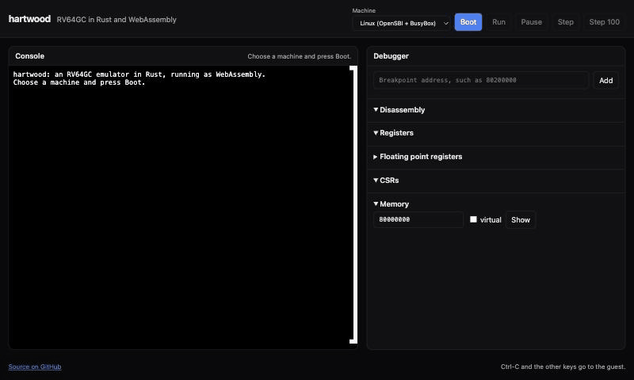
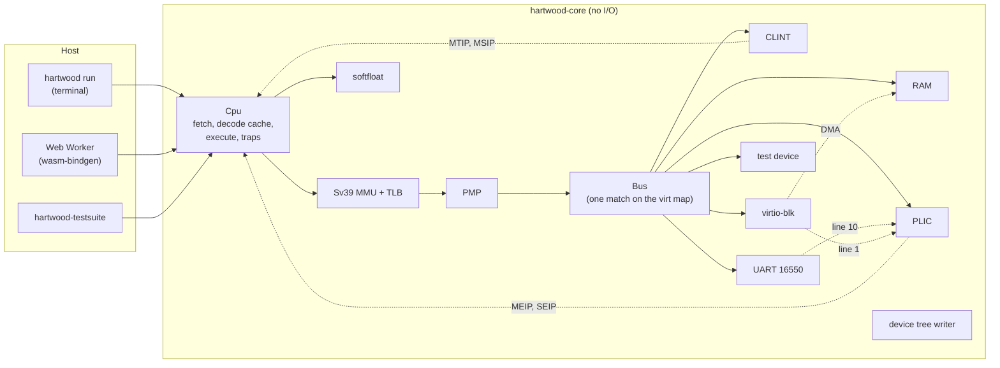

# hartwood

### An RV64GC emulator in Rust that boots Linux in the browser

_One core, for the terminal and for the web. No JIT, and no unsafe code._

  <a href="https://stiven-gjekaj.github.io/hartwood/"><b>Live demo</b></a> |
  <a href="#overview"><b>Overview</b></a> |
  <a href="#architecture"><b>Architecture</b></a> |
  <a href="#test-results"><b>Tests</b></a> |
  <a href="#speed"><b>Speed</b></a> |
  <a href="#run-it"><b>Run it</b></a> |
  <a href="#design-decisions"><b>Decisions</b></a> |
  <a href="docs/roadmap.md"><b>Roadmap</b></a>

---

> [!NOTE]
> **It boots Linux, in a terminal and in the browser.**
> Each of the 244 programs of the official riscv-tests suite for RV64GC
> passes. xv6 boots and passes its `usertests`. OpenSBI starts Linux 6.18,
> which runs BusyBox to a shell. The [live demo](https://stiven-gjekaj.github.io/hartwood/)
> does the same in a Web Worker, with a debugger beside the console.
> [docs/roadmap.md](docs/roadmap.md) holds each milestone and its exit
> test, and [docs/DECISIONS.md](docs/DECISIONS.md) holds every design
> decision and the reason behind it.

## Overview

hartwood emulates one RISC-V hart with the RV64GC instruction set: the base
integer set, multiply and divide, atomics, single and double precision
floating point, and compressed instructions. It has the M, S and U privilege
levels, the Sv39 MMU, 16 PMP entries and the Sstc timer.
Around the hart are the devices of the QEMU `virt` machine: a CLINT, a PLIC,
a 16550 UART, a virtio block device and the test device that turns the
machine off. hartwood writes the device tree, so OpenSBI and Linux find each
device with no change.

The same core crate builds for a native host and for WebAssembly:

- `hartwood run` boots a program on the terminal, with the UART as the
  console.
- The [web demo](https://stiven-gjekaj.github.io/hartwood/) runs the core in
  a Web Worker, with an xterm.js console and a debugger.

  

The recording comes from the live demo in a Chromium browser on an Apple M5. From
the press of Boot to the shell prompt takes about three seconds, at about
50 million instructions a second.

## What it does

| Area | Work |
|---|---|
| ISA | RV64I, M, A, F, D, C, Zicsr, Zifencei. The floating point is IEEE 754 in software, with each rounding mode and each flag. |
| Privilege | M, S and U modes, traps, `medeleg` and `mideleg`, interrupts, `wfi`, `mret` and `sret`, the counters, 16 PMP entries, Sstc. |
| Memory | Sv39 with a TLB and the hardware update of A and D. A misaligned load or store in RAM works. |
| Devices | CLINT, PLIC, 16550 UART, virtio block (MMIO, version 2), the `sifive,test0` power device, and a generated device tree. |
| Guests | The riscv-tests suite, xv6-riscv, and OpenSBI with Linux 6.18 and BusyBox. |
| Debugger | Run, pause, step, breakpoints, the registers and CSRs, memory through the page table, and a disassembly. |

## Architecture

| Crate | Work |
|---|---|
| [`crates/core`](crates/core) | The hart, the MMU, the bus, the devices, the ELF reader, the boot layout, the device tree, the disassembler. It reads no file and no clock, so it builds for `wasm32-unknown-unknown`. |
| [`crates/cli`](crates/cli) | `hartwood run`: the terminal console, `--trace`, scripted input, and the boot of an ELF file or of OpenSBI with a kernel. |
| [`crates/testsuite`](crates/testsuite) | Runs the riscv-tests programs and prints a table. |
| [`crates/wasm`](crates/wasm) | The wasm-bindgen API that the web frontend calls. |
| [`web`](web) | Vite, TypeScript and xterm.js. The emulator runs in a Web Worker. |

The time of the machine comes from the count of steps, not from the clock
of the host, so each run of a program is the same run. `wfi` moves the time
to the next timer event, so an idle guest costs nothing.

## Test results

Each program of the official [riscv-tests](https://github.com/riscv-software-src/riscv-tests)
suite for RV64GC passes, at the commit that `scripts/build-riscv-tests.sh`
names. The `-p-` form runs with no MMU, and the `-v-` form runs the same
test under Sv39 paging. CI runs all 244 on each push.

| Suite | Tests | `-p-` | `-v-` |
|---|---|---|---|
| rv64ui | the base integer set | 54 / 54 | 54 / 54 |
| rv64um | multiply and divide | 13 / 13 | 13 / 13 |
| rv64ua | atomics | 19 / 19 | 19 / 19 |
| rv64uc | compressed | 1 / 1 | 1 / 1 |
| rv64uf | single precision | 11 / 11 | 11 / 11 |
| rv64ud | double precision | 12 / 12 | 12 / 12 |
| rv64mi | M-mode | 17 / 17 | |
| rv64si | S-mode | 7 / 7 | |
| **all** | | **244 / 244** | |

The boots that CI runs on each push, from images that it builds from fixed
sources:

| Guest | Test | Result |
|---|---|---|
| xv6-riscv | boot, then `ls` | passes |
| xv6-riscv | `usertests` (66 tests) | `ALL TESTS PASSED` |
| OpenSBI 1.9, Linux 6.18.63, BusyBox 1.37 | boot, then `uname -a`, `ls /`, `cat /proc/cpuinfo` | passes in 86.1 million steps |
| The same Linux on QEMU | boot to the shell | passes |

`usertests` takes about half an hour, so it ran by hand and not in CI.
Besides these, 124 unit and integration tests check the decoder against the
assembler, the soft float against the host FPU on 400 000 random cases, the
MMU, the PMP, each device, the device tree and the boot layout.

## Speed

hartwood interprets each instruction. It has no JIT. Its time counts steps
(D19), so each workload below runs the same steps on each host, and the
speed is the steps divided by the CPU time of the process.
[scripts/bench.sh](scripts/bench.sh) runs each workload five times and
gives the median.

| Workload | Steps | Before M9 | After M9 | Change |
|---|---|---|---|---|
| xv6 boots and runs `ls` | 441.4 million | 72.7 M/s (6.07 s) | 94.1 M/s (4.69 s) | +29% |
| Linux boots and runs three commands | 86.1 million | 33.0 M/s (2.61 s) | 56.3 M/s (1.53 s) | +71% |

Measured on 2026-11-14 on an Apple M5, with no other load.
"Before" is commit `5eda156` with the `sfence.vma` fix added, because
without that fix Linux does not boot. In a Chromium browser, the same build runs
Linux at about 50 million steps a second.

The work followed a profile (D26). The four changes:

1. RAM reads and writes have a fixed width for each access, so the compiler
   makes one load and not a call to `memmove`.
2. The PMP keeps each decision with the range of addresses that it covers.
3. A cache of decoded instructions, keyed by the raw bits, so it never goes
   stale and needs no flush.
4. A fetch translates once, and reads 32 bits from RAM in one access.

Linux gains more than xv6 because it runs in S-mode with paging on, where
each access went through the PMP loop and the TLB.

## Run it

hartwood needs Rust. The toolchain file installs the pinned version.

    cargo build --release -p hartwood-cli
    target/release/hartwood run <program.elf>

Ctrl-A then X leaves the emulator, as in QEMU.

### The riscv-tests suite

The suite needs a RISC-V compiler for bare metal.

    brew install riscv64-elf-gcc                     # macOS
    sudo apt-get install gcc-riscv64-unknown-elf     # Ubuntu
    scripts/build-riscv-tests.sh
    cargo run --release -p hartwood-testsuite -- rv64

### xv6

    scripts/build-xv6.sh
    target/release/hartwood run build/xv6/kernel --drive build/xv6/fs.img

### Linux

The images build on Linux, and the images workflow in CI builds them on
each push. On Ubuntu:

    sudo apt-get install gcc-riscv64-linux-gnu flex bison bc cpio libssl-dev libelf-dev
    scripts/build-linux.sh
    target/release/hartwood run build/linux/fw_jump.bin --kernel build/linux/Image \
        --initrd build/linux/rootfs.cpio --ram-mib 256

On a Mac, take them from the last green run of the images workflow:

    gh run download --name linux --dir build/linux \
        $(gh run list --workflow images.yml --status success --limit 1 --json databaseId --jq '.[0].databaseId')

### The web frontend

The web frontend needs `wasm-pack` and Node.js. The boot images go in
`web/public/images/xv6` and `web/public/images/linux`.

    rustup target add wasm32-unknown-unknown
    brew install wasm-pack
    cd web && npm ci && npm run wasm && npm run dev

### Debug a guest

`--trace` prints each instruction, and `--trace-from <step>` starts the trace
late. Compare it with `qemu-system-riscv64 -d in_asm` to find the first
instruction where the two disagree.

## Design decisions

[docs/DECISIONS.md](docs/DECISIONS.md) holds each decision in full, with the
options that lost. In short:

- **One match on a fixed memory map** dispatches each access (D4). The map
  never changes, so a list of devices behind a trait gives nothing.
- **The decoder makes an operation and its operands** in one struct (D5).
  A compressed instruction becomes its 32-bit form first, so the code that
  runs it exists once.
- **A cache of decoded instructions keyed by the bits** (D26). The decode is
  a pure function of the bits, so an entry is never stale and the cache
  needs no flush, not even on `fence.i`.
- **The floating point is a module of its own** (D18). The host FPU has one
  rounding mode and no portable flags. Each result is exact in a `u128`
  first, then rounded once. 200 000 random cases match the host bit for bit.
- **A direct mapped TLB of 4 KiB entries** (D16). A hit checks the rights
  again, because SUM, MXR and the mode can change with no fence.
- **The hart sets A and D** (D17), as `rv64si-p-dirty` expects.
- **16 PMP entries with real checks** (D15), with each decision cached with
  the range that it covers. A first version had no PMP, and
  `rv64mi-p-pmpaddr` showed that this was wrong.
- **Time counts steps; `wfi` jumps to the next timer** (D19). Each run is the
  same run, and an idle guest costs no host time.
- **The device tree comes from the constants of the bus** (D22), so the tree
  and the bus cannot disagree.
- **The core does no I/O and uses std** (D3). CI builds it for wasm32, so a
  use of the file system breaks the build and not the page.
- **Linux comes from three direct builds, not from Buildroot** (D23): six
  minutes in CI instead of an hour, and the same shell.
- **The web worker runs slices of 20 ms and yields through a
  `MessageChannel`** (D25), because a hidden tab slows `setTimeout`.

## Future work

The plan put these out of scope: a JIT, the vector extension, the
hypervisor extension, more than one hart, and networking. Each one is a
good next step. So are the extensions that Linux uses when it finds them
(Zba, Zbb, Svnapot, Zicbom), a cache of basic blocks, and the
`riscv-arch-test` suite through RISCOF, which was a stretch goal of the plan.

## Licence

hartwood is under the [MIT licence](LICENSE). [TERMS.md](TERMS.md) says
what the licences of the guest images are.
